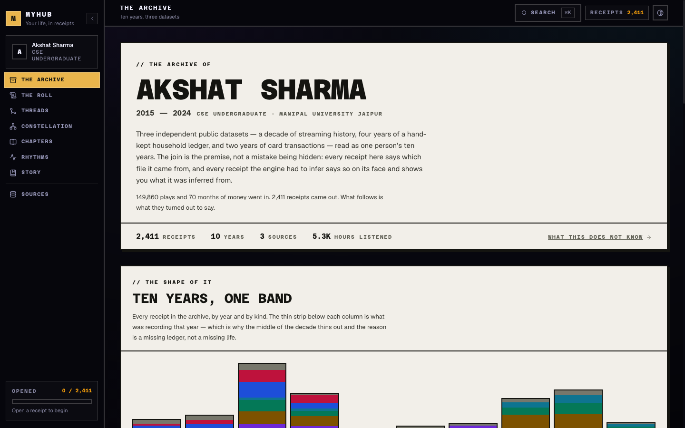
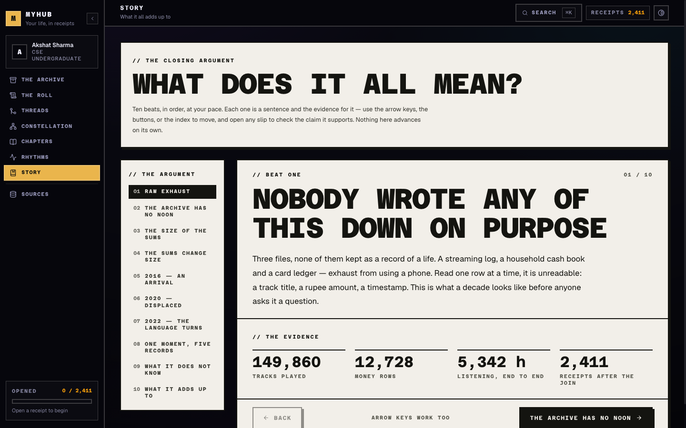
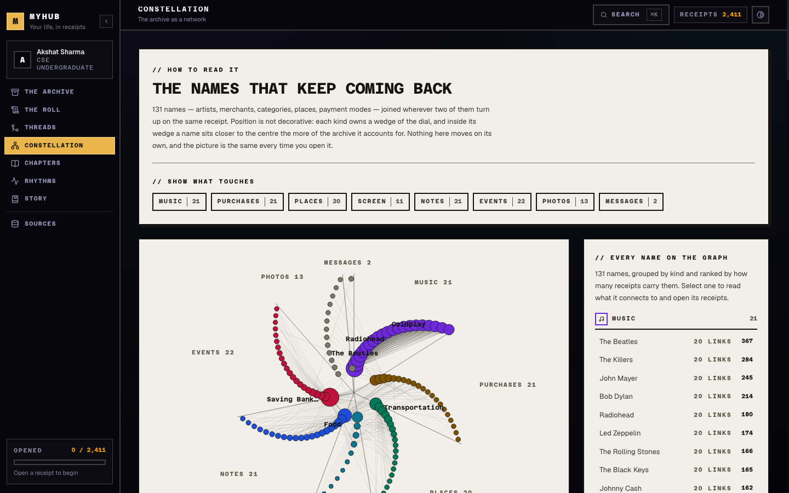
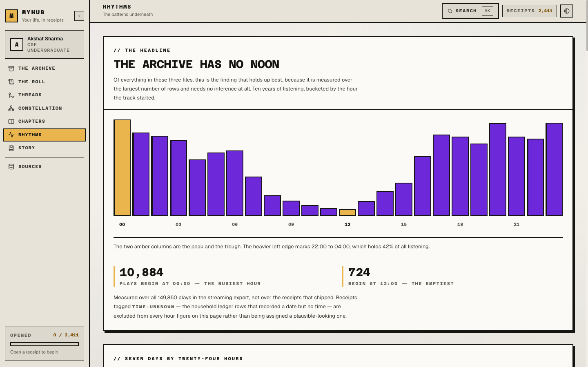
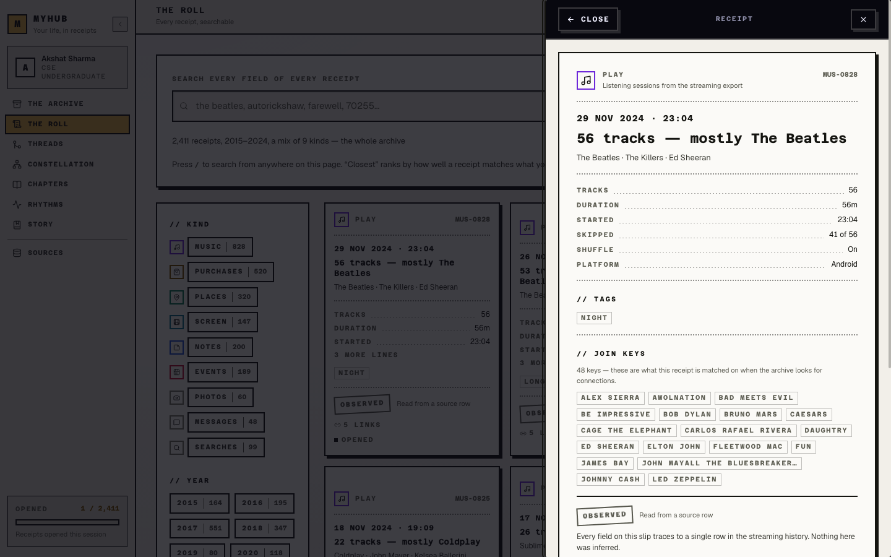
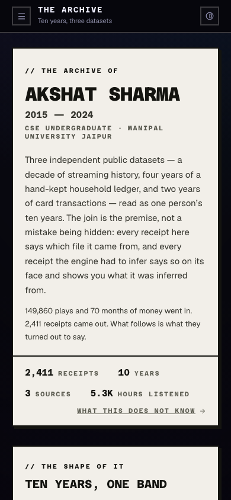

# MyHUB — Your Life, In Receipts 🧾

Three public datasets, 162,588 rows, one person's decade. MyHUB reads them as
**2,411 receipts** in nine kinds — plays, screen, places, purchases, notes,
events, frames, messages, searches — and then does the part that actually
matters: it finds what connects them and says what they add up to.

The archive is built as **Akshat Sharma**'s — CSE undergraduate, Manipal
University Jaipur — and `/sources` is blunt about what that does and does not
mean: not one row in any of the three files is the owner's. The ledgers are
public data read against one real calendar, with three dated anchors (class X
2020, class XII 2022, B.Tech from 2023) that come from a first-party record
rather than from any CSV. Everything else on screen is computed from the rows.
Nothing in this app pretends to know more than it does.



```
npm install
npm run dev      # http://localhost:3000
```

```
npm run build && npm start    # every page prerendered as static content
npm run lint                  # ESLint, Next's core-web-vitals + TypeScript rules
npm run verify                # build, then the browser verification suite
```

Node 20.9+ (developed on 22; the suite's unit check needs 22.18+). No environment
variables, no services to start, nothing to sign in to. `npm run verify` needs a
local Chrome or Chromium, and is described in
[`tools/audit/README.md`](tools/audit/README.md).

### Deploying

The site is live at **https://akshatsharma-x.github.io/MyHub/**. Every push to
`main` rebuilds and republishes it through
[`.github/workflows/deploy-pages.yml`](.github/workflows/deploy-pages.yml):
lint, a static export, and GitHub Pages.

It is plain HTML, CSS and JS with no server at all, so any static host can serve
it. GitHub Pages publishes a project under `/<repo>/`, so the workflow sets
`PAGES_BASE_PATH` to that prefix, and `next.config.ts` switches to
`output: 'export'` only when that variable is set. Every other build is
unchanged. To produce the same files locally:

```
PAGES_BASE_PATH=/MyHub npm run build    # writes the site to out/
PAGES_BASE_PATH= npm run build          # the same, for a host's domain root
```

### Regenerating the archive

`src/data/archive.json` is committed, so none of this is needed to run the app.
To rebuild it from source, put the three CSVs in `_raw/` under exactly these
names and run `npm run etl`:

```
_raw/spotify_history.csv
_raw/Daily Household Transactions.csv
_raw/Augmented_IndiaTransactMultiFacet2024.csv
```

The output is deterministic: the suite's `etl` check reruns it twice and requires
both runs to match the committed file byte for byte.

---

## The one thing to look at first

`/story` — a reader-paced argument in ten beats that moves **raw data →
insights → connections → story**, where every sentence is followed by the number
or the receipt that earns it. It ends on what the decade means, which is the
question the brief actually asks.

If you only have two minutes: the front page's decade spine, then `/story`.

## The eight routes

| route | the question it answers |
|---|---|
| `/` | what is this, whose is it, where do I start — a decade spine, one worked thread, three findings |
| `/roll` | where is the specific thing I am looking for — full-text search, faceted filters with live counts, four sorts |
| `/threads` | which of these things happened together — 120 threads, each a chain with the reason printed on every connector |
| `/constellation` | what is connected to what across ten years — 131 entities on a deterministic dial, positioned by kind and weight |
| `/chapters` | who was this person, era by era — six eras with identical stat blocks on shared scales, built for comparison |
| `/rhythms` | what was true about this person that they never noticed — the hour dial, the 7×24 week grid, 14 findings with evidence |
| `/story` | what does it all mean |
| `/sources` | should I believe any of this — every row count, every caveat, every inference, in full |

Plus a shared **receipt overlay**, reachable from every card on every page: the
full receipt, its provenance stamp, and its related receipts *with the derived
reason printed for each*. Click one and the overlay walks to it, so a reader can
travel the graph receipt by receipt without leaving the page they came from.

`docs/PAGES.md` is the route spec, including which of the judged requirements each
route carries and how the responsive and typographic claims were measured.

| | |
|---|---|
|  |  |
|  |  |

<p align="center"></p>

The screenshots are generated from the production build by
`node tools/audit/screenshots.mjs`, so they can be redrawn whenever the design
changes.

## Not a timeline

The explicit anti-requirement, so it is worth being direct: no route is a
chronological list of cards. `/roll` comes closest and is deliberately a
*searchable corpus* with a default sort. Relationships are discovered through
three independent mechanisms, not one:

- **Threads** — receipts that co-occur in time and in content, chained, with the
  link reason stated, as the engine actually phrases it: *Only 2h apart, the same
  evening.* · *Both carry Saving Bank Account 1, 4h apart.* · *A search
  reconstructed from "152 tracks — mostly The Beatles".*
- **Constellation** — the archive as a network of *entities* rather than
  receipts, so it has something to say instead of being a hairball. Layout is
  deterministic: the same picture every load, and nothing animates on its own.
- **Rhythms** — patterns nobody would notice by scrolling. The archive has no
  noon. Money stops for two years while listening never does.

## How the data reaches the browser

```
_raw/*.csv  ──▶  node tools/etl.mjs  ──▶  src/data/archive.json  ──▶  import
 (gitignored)      (build-time, once)        (1.3 MB, committed)      (bundled)
```

- **Build-time ETL, static JSON module, bundled import.** There is no API route,
  no database, no authentication, and no runtime network call of any kind — no
  `fetch`, no XHR, no WebSocket, no server action. The production build reports
  every page as `○ (Static)`.
- **One localStorage key**, `app_theme`, for the theme. That is the only thing
  this app persists. The receipt overlay is in-memory on purpose: closing the tab
  forgets where you were.
- Threads, links, entities, patterns, chapters and story facts are **derived in
  the browser** at module scope from the one JSON import — computed once, never
  fetched.
- The ETL is deterministic (sort plus stride, no RNG), so two runs of
  `node tools/etl.mjs` over the same `_raw/` produce byte-identical output. It
  refuses to write a file that fails its own sanity pass. **No part of any card
  number leaves it** — the rule was to keep only the last four digits, until the
  column turned out to be a stringified float with no last four digits in it to
  keep.

The three sources, as the app itself reports them:

| file | rows | span | receipts |
|---|---|---|---|
| `spotify_history.csv` | 149,860 | 2013-07 → 2024-12 | 927 |
| `Daily Household Transactions.csv` | 2,461 | 2015-01 → 2018-09 | 884 |
| `Augmented_IndiaTransactMultiFacet2024.csv` | 10,267 | 2022-04 → 2024-04 | 600 |

## Observed vs reconstructed

2,204 of the 2,411 receipts are **observed** — a row in a file says this
happened. 207 are **reconstructed**: the datasets contain no photos, messages or
searches, so those three kinds are inferred from card use, transfers and first
appearances, under a stated rule. Provenance is encoded in colour, stamped on
every receipt, and explained on `/sources`. The 2019–21 gap — music and no money —
is drawn as a gap rather than smoothed over, and the chapter covering it renders
its missing spend as *the ledger stops here*, not as `₹—`.

## The design language

Neo-brutalist editorial: cream paper sheets floating on a near-black room, chrome
sitting behind the canvas, 2px hard ink rules, hard offset shadows with zero blur,
heavy geometric mono for anything printed, and a single amber accent used only as
a block fill. No glows, no neon, no gradient heroes, no glass, no animated
borders, no noise. Square by default — only dots, rings and avatars stay circular.

Two themes, one design, depth order never inverted. Theming is carried by
Tailwind v4's `@theme inline`: `.k-paper`, `.k-room` and `.k-receipt` *redefine*
the colour tokens rather than adding new names, so re-inking an entire subtree is
one class and zero per-component branching. `src/app/globals.css` carries the
contrast tables that make those ramps auditable — including the wash-composited
surfaces that a naive table omits — and those comments are load-bearing.

Nothing that carries a fact is set below 11px, and the strings `undefined`,
`null` and `NaN` are not allowed to reach the screen; every number on screen goes
through `src/lib/format.ts`.

Both of those are checked rather than asserted, by a suite that lives in the
repository: `npm run verify`. It drives the production build in headless Chrome
across 8 pages × 4 widths × 2 themes for overflow, clipping, the 11px floor and
those sentinel strings, then the surfaces a load-time pass can never see, every
keyboard path, WCAG contrast, layout shift, and the brief's runtime constraints
(same-origin reads only, one storage key). Every detector is proved to fire on an
injected defect before its clean result is believed. The floor is measured
through each element's screen CTM, because `getComputedStyle().fontSize` reports
an SVG label's *specified* size and not the size it renders at.
[`tools/audit/README.md`](tools/audit/README.md) lists each check and each ruler
that was once wrong.

## Layout

```
src/app/          one directory per route, plus globals.css and the root layout
src/components/   layout (shell, rail, topbar) · receipt · thread · pattern · charts · ui
src/lib/          archive.ts (the import) · engine/ (links, threads, entities,
                  patterns, chapters, story) · format.ts · kinds.ts · theme.ts
src/data/         archive.json — the committed ETL output
tools/            etl.mjs and the CSV reader it uses · audit/ (the verification suite)
docs/             DATA_BRIEF.md (what the data is) · SOURCES.md (what it knows)
                  PAGES.md (the route spec)
```

Next.js 16 App Router · React 19 · TypeScript strict · Tailwind CSS v4 ·
framer-motion · lucide-react.
